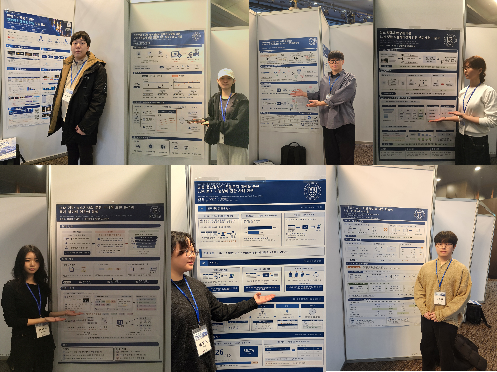

<figure style="display:inline-block; margin:0 12px;">
    
    <figcaption align='center'></figcaption>
</figure>

### 소식 알림

연구실의 김승주, 송유진, 이정경, 오지수, 임성택, 조태승, 전유리 학생이 2026 한국ITS학회 추계학술발표대회에 참가하였습니다.

### 세부 내용

제주한라대학교 한라컨벤션센터에서 개최된 한국ITS학회 추계학술대회에 참가하였습니다. 이번 학술대회에 참가한 학생들은 논문을 발표하며 주목을 받았습니다.
발표한 논문:
- 스마트폰 사진 기반 빛공해 위반 가능성 사전 선별 AI 시스템 / [LINK](https://www.datasciencelabs.org/papers/its2026-fall-A-Smartphone-Image-Based-Pre-screening-AI-System-for-Light-Pollution-Violations/)
- 공공 공간정보의 온톨로지 매핑을 통한 LLM 보조 가능성에 관한 사례 연구 / [LINK](https://www.datasciencelabs.org/papers/its2026-fall-A-Case-Study-on-the-Feasibility-of-LLM-Assistance-in-Ontology-Mapping-of-Public-Geospatial-Data/)
- 뉴스 맥락의 확장에 따른 LLM 댓글 시뮬레이션의감정 분포 재현도 / [LINK](https://www.datasciencelabs.org/papers/its2026-fall-news-context-enrichment/)
- LLM 기반 뉴스기사의 문장 수사적 표현 분석과 독자 참여의 연관성 탐색 / [LINK](https://www.datasciencelabs.org/papers/its2026-fall-LLM-Based-Analysis-of-Rhetorical-Features-in-News-Articles-and-Their-Associations-with-Reader-Engagement/)
- Hypercone 기반 구면 임베딩을 활용한 텍스트 오픈셋 의도 분류 및 이상치 거부 모델 설계 [LINK](https://www.datasciencelabs.org/papers/its2026-fall-Design-of-an-Open-Set-Intent-Classification-and-Out-of-Distribution-Rejection-Model-for-Text-Using-Hypercone-Based-Hyperspherical-Embeddings/)
- 단일 이미지를 이용한 빛공해 위반 의심 광원 자동 탐지 / [LINK](https://www.datasciencelabs.org/papers/its2026-fall-Automatic-Detection-of-Light-Sources-Suspected-of-Light-Pollution-Violations-Using-a-Single-Image/)
- 제조분야 LLM 에이전트의 선택적 실행을 위한작업 복잡도와 행동 위험도 기반 동적 신뢰도 계산 / [LINK](https://www.datasciencelabs.org/papers/its2026-fall-Dynamic-Confidence-LLM-Agent/)
