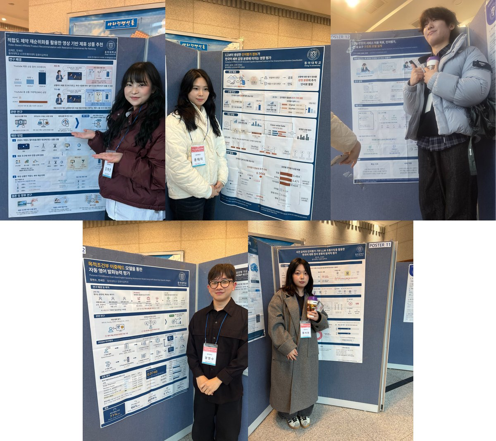

<figure style="display:inline-block; margin:0 12px;">
    
    <figcaption align='center'></figcaption>
</figure>

### 소식 알림

연구실의 김동현, 김채은, 윤태이, 이현기, 장연수, 황서현 학생이 2026 한국멀티미디어학회 추계학술발표대회에 참가하였습니다.

### 세부 내용

제주대학교 아라컨벤션홀에서 개최된 한국멀티미디어학회 추계학술발표대회에 참가하였습니다. 이번 학술대회에 참가한 학생들은 논문을 발표하며 주목을 받았습니다.
발표한 논문:
- 규칙과 LLM을 혼용한 루브릭 기반 고객 안내 메시지 품질점검 파이프라인 제안 / [LINK](https://www.datasciencelabs.org/papers/kmms2026-fall-Rubric-Based-Customer-Message-Quality-Check/)
- 적합도 제약 재순위화를 활용한 영상 기반 제휴 상품 추천 / [LINK](https://www.datasciencelabs.org/papers/kmms2026-fall-Video-Based-Affiliate-Product-Recommendation/)
- LLM이 생성한 인지평가 정보가 한국어 세부 감정 분류에 미치는 영향 평가 / [LINK](https://www.datasciencelabs.org/papers/kmms2026-fall-LLM-Cognitive-Appraisal-Korean-Emotion-Classification/)
- 금융 민원의 서비스 이용 목표, 인지평가, 현재 요구 구조화 모델 설계 / [LINK](https://www.datasciencelabs.org/papers/kmms2026-fall-Financial-Complaint-Structuring-Model/)
- 목적조건부 이중헤드 모델을 통한 자동 영어 발화능력 평가 / [LINK](https://www.datasciencelabs.org/papers/kmms2026-fall-Purpose-Conditioned-Dual-Head-Speaking-Assessment/)
- 사건 요약과 인지평가 기반 LLM 프롬프팅을 활용한 한국어 대화 정서 분류의 탐색적 평가 / [LINK](https://www.datasciencelabs.org/papers/kmms2026-fall-Event-Summary-Appraisal-Korean-Emotion-Classification/)
