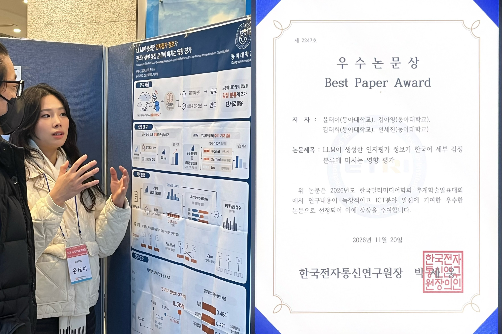

<figure>
    
    <figcaption align='center'>한국멀티미디어학회 우수논문상</figcaption>
</figure>

### 수상소식 알림

본 연구실의 **윤태이** 학생이 2026 한국멀티미디어학회 추계학술발표대회에서 우수논문상을 수상하였습니다.

수상 논문:
- LLM이 생성한 인지평가 정보가 한국어 세부 감정 분류에 미치는 영향 평가 / [LINK](https://www.datasciencelabs.org/papers/kmms2026-fall-LLM-Cognitive-Appraisal-Korean-Emotion-Classification/)